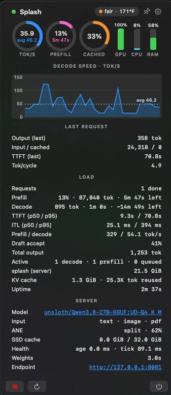
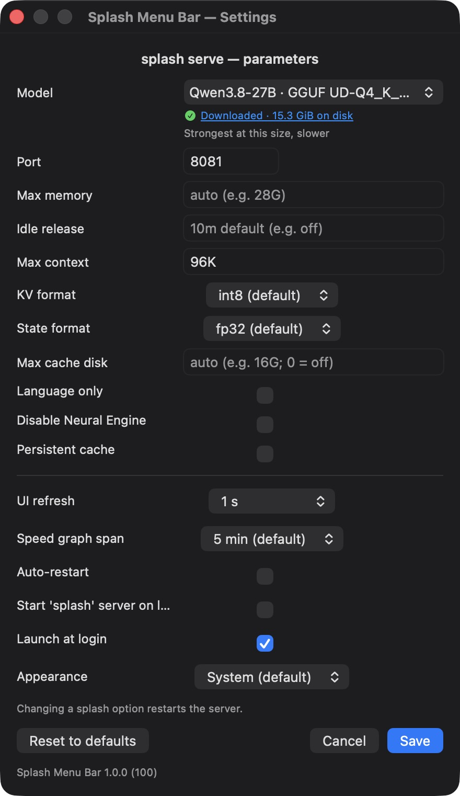

# Splash Menu Bar

A macOS menu bar utility that runs `splash serve`, keeps the process alive,
and surfaces its live inference metrics. [Splash](https://github.com/incoai/splash)
is incoai's local inference engine for Apple silicon. This app is a companion
to it, not part of that project.

## Screenshots

The flyout while a request is decoding: tok/s, prefill and cache gauges,
GPU/CPU/memory bars, the speed-over-time graph, and per-request and server
details.



The Settings window: the `splash serve` parameters, UI refresh, appearance
and the footer actions.



## What it does

- **Install check**: at launch (and whenever you press **Start**) the app
  looks for `splash` on its PATH. If it is missing, it offers to either have
  you install it yourself (**Copy Command** copies `brew install incoai/tap/splash`)
  or let the app run that Homebrew install for you, streaming live output in
  a progress window. If the install goes quiet for 5 minutes (a stalled
  network, or an Xcode license that brew cannot ask for non-interactively)
  it says so and suggests `sudo xcodebuild -license accept`. Once the install
  succeeds, the server starts if you pressed Start (or Start 'splash' server
  on launch is on); otherwise the flyout shows the Get started tip. If
  Homebrew itself is not found, it points you to https://brew.sh.
- **Finds a running splash**: at launch the app looks for a splash server
  that is already running — on the configured port, or on any port a splash
  process is listening on (located with `lsof`/`ps`, confirmed via `/status`)
  — and attaches to it. While none is connected it keeps checking every 5 s,
  so a `splash serve` started later in a terminal is picked up automatically.
  Stop and Restart act on that server's port.
- **Start on launch (opt-in)**: if no splash is running at launch and
  **Start 'splash' server on launch** is on in Settings, the app launches
  `splash serve` with the configured parameters. It is off by default: the
  flyout shows a **Get started** tip instead (pick a model in Settings, then
  press Start), and on the very first launch it opens the flyout so the tip
  is seen.
- **Start / Stop / Restart**: the flyout's icon buttons switch between a
  green ▶ **Start** and a red ■ **Stop** depending on whether a server is
  actually serving the configured port. Stop, Restart and Quit (⏻) ask for
  confirmation first. **Stop** shuts the server down even when it was started
  outside the app: it locates the splash server listening on the port plus
  its `serve-native` engine, SIGTERMs both, then SIGKILLs after 5 s. A
  process on the port that is not splash is never touched, and a `/status`
  reply that is not splash's is not mistaken for a running server. If the
  server dies on its own the flyout shows a crash card (how it died, plus its
  last output lines) and offers to start it again — or, with **Auto-restart**
  on in Settings, starts it again automatically after a moment: up to 3
  consecutive crashes, then it gives up (pressing Start resets the count; a
  Stop always cancels a pending restart). Quitting the app stops only its own
  server (and its engine, waiting up to 3 s so nothing is left holding the
  model); an externally started server is left running.
- **Pin**: the pin icon in the flyout's header keeps the flyout open: clicking
  elsewhere, pressing Esc, clicking the menu bar item or using its buttons no
  longer closes it until you click the pin again to unpin it. While pinned you
  can drag it anywhere on screen by its top edge (the pointer turns into a
  hand there); unpinning snaps it back under the menu bar item. The pin state
  and the pinned position persist across app restarts: a pinned flyout comes
  back pinned where you left it (or under the menu bar item if that spot is no
  longer on any screen).
- **Startup progress**: until splash reports Ready, the flyout shows a
  *Starting up* card: the current stage (preparing, downloading `owner/repo`,
  loading weights, starting the server), a progress bar with size, speed and
  time left while the model downloads, elapsed time, and the latest line
  splash printed. The menu bar reads `● 42%` during a download, the dot is
  yellow while starting up, green once serving with no requests yet (the
  flyout's status dot uses the same colors), and its tooltip names the stage.
  If splash exits, the flyout shows its last output line.
- **Live metrics** from the server's `GET /status` endpoint, polled every
  2 s by default (configurable):
  - **tok/s gauge** (live decode batch, falling back to the lifetime decode
    speed and the last log-parsed request), a **prefill gauge** (the running
    prefill batch's tok/s, falling back to the lifetime prefill speed; full
    ring = 500 tok/s) and a **cache-hit gauge**: the lifetime KV hit rate —
    the share of prompt tokens served from the cache instead of being
    prefilled again (the per-request figure is LAST REQUEST → "Input / cached")
  - **tok/s line graph over time** (sampled from the polled status), with a
    0-based Y axis labeled at round steps and a dotted average line
  - load: completed/cancelled/failed requests, TTFT p50/p95, prefill and
    decode speed, total output, active requests (decode/prefill/queued),
    the whole Mac's memory (the "RAM" bar), the splash server's own
    memory ("splash (server)"), uptime, thermal state, and the chip
    temperature (the hottest Apple silicon die sensor, read through IOKit's
    HID event system; shown in °F or °C per System Settings › General ›
    Language & Region)
  - **prefill progress**: while a request is in its prompt phase,
    `prompt_processed / prompt_tokens` from `active_requests` with an
    estimated time left (remaining tokens ÷ current prefill speed)
  - **server memory**: `memory_actual.current_bytes` from the endpoint,
    with the peak since the server started when it's higher
  - **engine health**: the app's child is the Python wrapper; if the
    `serve-native` engine under it crashes, the wrapper restarts it and the
    server stays "up" from the app's point of view. The flyout therefore
    shows a warning card when `/status` reports the engine recovering,
    having restarted, or Metal being unhealthy (`transport.recovering`,
    `transport.restarts`, `metal.healthy`, failure counters)
  - **memory pressure**: the Mac's memory pressure as seen by the server
    (`memory_pressure`) colors the RAM load bar — green = normal,
    yellow = warning, red = critical (orange until the first status
    arrives; a user-picked bar color, if any, shows while the pressure is
    normal). The raw state wobbles around its threshold, so a new color
    takes effect only after two consecutive polls reporting it
- **Last request** detail (from splash's stdout lines): output, input/cached,
  TTFT, tok/cycle. Shown only once a request has finished — an adopted
  (external) server has no log for the app to parse, and `/status` carries
  no per-request record. The flyout's **Model** row and Settings'
  "Downloaded · N on disk" line are links that open the model's folder in
  the Hugging Face cache in Finder.
- **Crash card**: when splash exits, the flyout shows how it died — "exited
  with code N" or "killed by signal N" — and its last output lines (a
  Python traceback is multi-line), selectable for copying. A macOS
  notification ("splash exited", with a **Start splash** action) is posted
  too, unless an auto-restart is about to happen. Other banners: **Model
  ready** (when a startup that actually downloaded files reports Ready),
  **Thermal: serious / critical** (on each crossing into a hot state), and
  **splash released the model** (when the server frees the weights from
  memory after idleness). If a *non-splash* service holds the port, the
  child dies with "address in use" and the flyout instead shows an orange
  **port in use** card — "Something else (not splash) is serving port N…
  Stop that service — or change the port in Settings — then press Start."
- **Server version**: hovering the menu bar item — or the flyout header's
  "Splash" status and name — shows the version of the splash server that is
  serving — read from the install the server process
  was launched out of (the version in its Homebrew Cellar path, or the
  install's own `bin/splash --version`), so it stays correct after a
  `brew upgrade` replaces or removes that install. If the server's install
  can't be identified, the PATH's `splash --version` answers instead; with
  no server serving, the tooltip is just "Splash".
- **Update check**: at launch and each time a server starts, the app
  fetches the newest splash release (the GitHub release the Homebrew formula
  tracks) and compares it with the `splash` installed on the PATH. When a
  newer one exists, the flyout shows an update card — "splash X.Y.Z
  available" (installed version underneath) with an **Update Splash**
  button. The button asks for confirmation, then runs
  `brew upgrade incoai/tap/splash` in the same progress window as the
  install. Once the upgrade succeeds and a server is running, the app asks
  whether to restart it — a running server keeps using the old binary until
  it is restarted (a stopped server picks the new version up on Start).
- The status bar item shows the live tok/s while decoding, e.g. `▣ 78.5 t/s`; while a prompt is prefilling (and nothing is decoding) it shows the prompt progress instead, e.g. `▣ ◐ 46%`; when the server is idle it shows a green ●.

## Build

```sh
make          # builds SplashMenuBar.app (needs the Xcode/CLT Swift toolchain)
make run      # builds and launches
make test     # runs the unit tests (XCTest; needs a full Xcode, not just the CLT)
make version VERSION=1.1.0   # sets the app version in Info.plist (build = 110)
make clean
```

## Settings

Open the gear icon in the flyout (or press ⌘, after focusing it). The dialog
edits the full `splash serve` command line, persisted to
`~/.splashmenubar.json`; saving restarts the server:

| Field | Flag | Notes |
|---|---|---|
| Model | `--model` | drop-down of splash's suggested models (read from `suggested-models.tsv` shipped with the installed splash, so the list tracks splash's releases; a built-in table is the fallback), grouped into Downloaded (with size on disk) and Not downloaded (with download size); a one-line description and, for models that outgrow the machine, a "needs about N GB of RAM" warning; **Custom…** takes any `OWNER/REPO[:VARIANT]` |
| Port | `--port` | e.g. `8081` |
| Max memory | `--max-memory` | e.g. `28G` (blank = auto) |
| Idle release | `--idle-release` | e.g. `off` (blank = default 10m) |
| Max context | `--max-context` | e.g. `100K` (blank = auto) |
| KV format | `--kv-format` | `int8` (default) or `bf16` |
| State format | `--state-format` | `fp32` (default) or `bf16` |
| Max cache disk | `--max-cache-disk` | e.g. `16G`; `0` turns it off (blank = auto) |
| Language only | `--language-only` | skip vision |
| Disable Neural Engine | `--disable-ane` | prefill on GPU alone |
| Persistent cache | `--persistent-cache` | keep the SSD cache across restarts |

Blank optional fields and default pickers omit the flag entirely.

Downloaded models are found in the Hugging Face cache (`HF_HUB_CACHE`, else
`HF_HOME/hub`, else `~/.cache/huggingface/hub`), where splash downloads them.
Other GGUF variants of the supported repos found there are listed too.

Below the splash options, **UI refresh** sets how often the app polls
`/status` to update the flyout and menu bar: 500 ms, 1 s, 2 s (default), 5 s
or 10 s. It is stored in the same file as `refreshInterval`; changing only
this does not restart the server. **Speed graph span** sets how many minutes
of generation the tok/s graph shows: 1, 3, 5 (default), 10, 15 or 30 min,
stored as `graphMinutes`; it also does not restart the server. **Auto-restart**
(stored as `autoRestart`) restarts the server automatically if it exits on its
own — up to 3 consecutive crashes before giving up; changing only this does
not restart the server. **Start 'splash' server on launch** (stored as
`startServerOnLaunch`, off by default) starts splash whenever the app
launches. **Launch at login** (stored as `launchAtLogin`) registers
the app as a system login item (System Settings › General › Login Items), so
it starts when you log in — and the splash server too, with Start server on
launch on; a registration failure is
reported and not saved. **Appearance** (stored as `theme`) picks the UI's
color scheme — System, Light or Dark — for the flyout and every window.
**Reset to defaults** in the footer puts every field
back to its default (blank = splash's own default for that flag); nothing is
saved until you press Save.

**Gauge colors**: right-click any ring (tok/s, prefill, cache-hit), any load
bar (GPU, CPU, RAM) or the DECODE SPEED graph and choose **Color…** to
open the system color panel for that element — it updates the gauge as you
pick, and the choice persists in the same file (`gaugeColors`). (A color
well cannot sit inside a context menu on macOS, hence the panel.) The Mac
RAM bar shows its pressure color (yellow/red) instead of a picked color
while the server reports warning or critical memory pressure.

Every element in the flyout and the Settings window carries hover text
explaining it.

`splash` is resolved from `PATH`; since apps launched from Finder get a
minimal PATH, `/opt/homebrew/bin`, `/usr/local/bin`, and `~/.local/bin` are
prepended automatically.

## How it works

- `SplashProcess` owns the `splash serve` child process, reads stdout/stderr
  on dedicated threads (blocking `availableData` loops) and dispatches
  complete lines to the main thread. `SplashParser` turns lines into events
  (Started/Done requests, thermal transitions, the Ready line, weights load,
  and startup stages). Lines are split on `\r` as well as `\n` so download
  progress bars come through, and the child gets `TQDM_POSITION=-1`, which
  makes huggingface_hub draw its byte-level bars even though stderr is not a
  TTY.
- `StatusClient` polls `http://127.0.0.1:<port>/status` every 2 s through a
  small `URLProtocol` that opens the loopback socket directly, so system
  proxy settings (including PAC configs that route 127.0.0.1) cannot
  intercept the poll; a single failed poll does not flip the ready state —
  two consecutive failures do. The same port probe classifies what answers
  on the port (splash, another service, or nothing), which is what drives
  adoption and the "port in use" card. `MetricsStore` merges the polled
  snapshot with the log-derived per-request data into one `@Published`
  state.
- The flyout is a borderless, non-activating `NSPanel` positioned just below
  the menu bar on the status item's screen, clamped inside the screen (the
  body scrolls and the control bar stays pinned when it cannot fit). It
  dismisses on outside click, Escape, or clicking the status item again.

## Notes

- The app is unsigned; open it with `make run` or by double-clicking
  `SplashMenuBar.app` on your own machine.
- While a request is in flight the last completed values stay on screen;
  endpoint metrics update every 2 s.

## License

Apache License 2.0 — the full legal text is in [LICENSE](LICENSE).
